# Detailed experiment history

[Repository overview and current commands](README.md). Training data and historical source snapshots are preserved.

**GitHub username:** Dorrie-ge
**Repository:** [Dorrie-ge/mlds-assignment1-rl](https://github.com/Dorrie-ge/mlds-assignment1-rl)

**Visibility:** public, verified October 23, 2026.

This repository implements the shuttle dispatch MDP, episodic REINFORCE, and
REINFORCE with a learned state-value baseline. Results are measured runs. Short
training budgets do not establish that a game is solved. Failed runs are retained.

<!-- COMPLETE_REPORT START -->
## Complete report and final evidence

[Download the complete PDF report](reports/assignment1_report.pdf). Updated 23 October 2026.
The report covers the initial implementation, retained failures, controlled improvements,
independent seed confirmation, required figures, edge cases, quantitative validation and
the additional three-month experiment plan. All values come from stored measurements.

### Improved Pong extension: independent training seeds

| Training seed | Role | 500-episode mean +/- sample SD |
|---|---|---:|
| 0 | selection_run | -7.742 +/- 6.311 |
| 1 | independent_confirmation | -9.250 +/- 3.668 |
| 2 | independent_confirmation | -10.032 +/- 3.796 |

The two independent confirmation runs average -9.641.
Across all three policy means: -9.008, with between-seed sample SD 1.164.
Pong learning improved, but mean scores remain negative. Three seeds are a small sample.
The improved extension uses uniform actor time weights; the exact start-state discounted
objective is preserved in the separately reported four core experiments.

[Requirement-to-evidence map](results/report_requirements.json) and
[raw-data report evidence hashes](results/report_evidence.json) support the report.
Regenerate without training: `python src/prepare_report_figures.py` then `python src/build_report.py`.
Submit the PDF to Canvas; a GitHub update alone does not submit the assignment.
<!-- COMPLETE_REPORT END -->

## Installation

Python 3.12 was used. Create a local environment, then install the recorded dependencies:

```bash
python3 -m venv .venv
source .venv/bin/activate
python -m pip install -r requirements-lock.txt
```

The lock file records the actual macOS ARM CPU run. On a different platform,
`requirements.txt` provides the top-level dependencies; record any version changes.
Neither the virtual environment nor Atari ROM files are committed.

## Reproduce the main experiments

Run from the repository root. CartPole and the historical runs used CPU and one
PyTorch thread. The batched Pong retry used Apple MPS; `--device cpu` is supported
but hardware and floating-point differences can change stochastic training results.
Each game command evaluates both a random policy and the final stochastic policy
on 500 episodes. Evaluation freezes the trained weights and uses separate seeds.

```bash
python src/shuttle.py --out runs/shuttle
python src/validate_shuttle_simulation.py
python src/policy_gradient.py --test-only
python src/policy_gradient.py --game cartpole --baseline none --lr 0.001 --episodes 2000 --eval-episodes 500 --out runs/cartpole_none_lr0001
python src/policy_gradient.py --game cartpole --baseline value --lr 0.001 --episodes 2000 --eval-episodes 500 --out runs/cartpole_value_lr0001
python src/pong_batch.py --baseline none --lr 0.0001 --episodes 1000 --batch-episodes 8 --eval-episodes 500 --device mps --out runs/pong_batch_none
python src/pong_batch.py --baseline value --lr 0.0001 --episodes 1000 --batch-episodes 8 --eval-episodes 500 --device mps --out runs/pong_batch_value
```

These commands write new measurements to `runs/`, leaving the committed `results/`
available for report regeneration and direct validation. Choose another fresh
output directory for subsequent repeats. `src/pong_batch.py` refuses to silently
overwrite a training CSV; it supports `--resume PATH_TO_CHECKPOINT` for an interrupted
run using its original directory. The paired experiments use seed 0. Historical
lr=0.01 runs and all three CartPole lr=0.001 seeds remain in `results/`. For a
quick environment demo, use `--episodes 5 --eval-episodes 5` for CartPole or
`--episodes 2 --eval-episodes 2` for Pong, and choose another output directory.
Those small evaluation budgets do not meet the assignment's 500-episode requirement.

Per-run budgets are recorded in the experiment manifests. The later improvement
comparisons hold fresh-run budgets at 3,000 episodes; no unrun longer-budget scores
are reported.

## Shuttle MDP

- State `s`: customers waiting before dispatch, 0 through 200.
- Action `a`: wait (0), or dispatch one shuttle (1), capacity 15.
- Customers remaining: `left = max(s - 15*a, 0)`.
- Immediate cost: `100*a + 2*left`.
- Next state: `min(200, left + A)`, with independent uniform arrivals 1 through 5.
- Discount: 0.95. Ties choose wait. Empty dispatch is allowed and costs 100.

Dispatch occurs before holding cost and arrivals. Arrivals above the queue cap
are discarded without additional penalty; this is an explicit boundary assumption.
Finite-horizon terminal cost at time 500 is zero. Values plotted here are positive
costs to minimize. With reward `r=-cost`, reward-maximizing values have the opposite sign.

Finite-horizon enumeration means enumerating all states, actions, and arrival
outcomes in backward induction. It does not mean enumerating 2^500 open-loop
action sequences. A classroom-specific definition of enumeration should be checked
against the course notes.

The infinite-horizon policy waits at states 0-12 and dispatches at 13-200.
Its optimal expected discounted cost at state 0 is approximately 576.670168.
The VI stopping rule is a maximum Bellman residual below 1e-10. PI solves the
policy's linear system and improves the policy until unchanged.

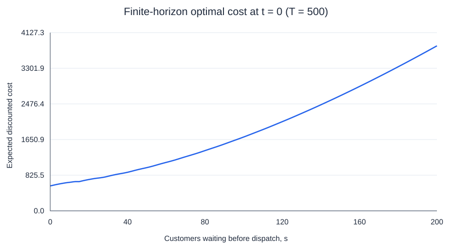
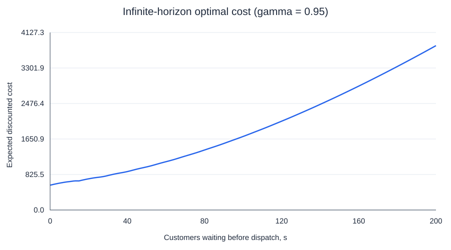
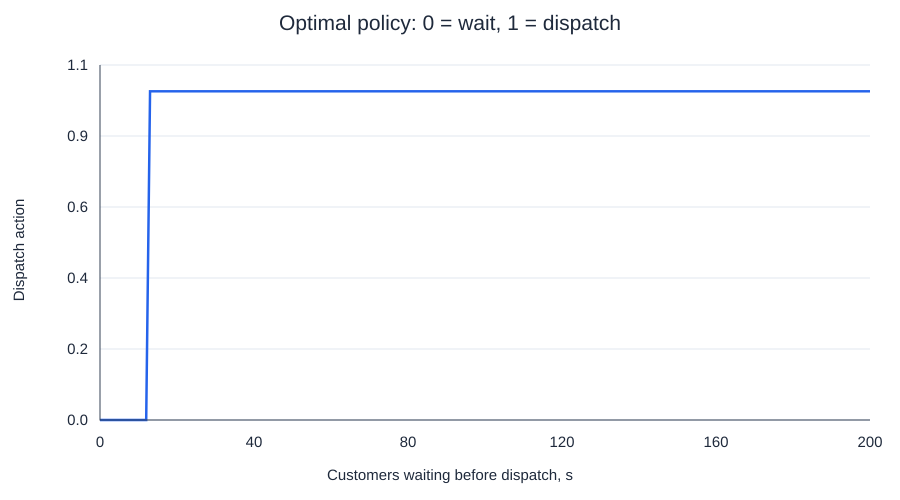

`results/shuttle/values.csv` contains all values; `validation.json` records the
executed tests. VI and PI agree on every state action. Their maximum value
difference is below 2e-9. The finite-horizon versus infinite-horizon difference
is below 3e-9 for T=500.

## Policy gradient implementation

The optimization target is the start-state discounted episode return
`J = E[sum_t gamma**t * r_t]`. Rewards-to-go are computed over the full episode:
`G_t = sum_{k=t}^{T-1} gamma**(k-t) * r_k`.
The actor minimizes `-sum_t gamma**t * log pi(a_t|s_t) * (G_t - b(s_t))`.
The explicit outer `gamma**t` preserves this particular discounted objective.
It also downweights late actions in long Pong games; this is a limitation to examine.

Without a baseline, `b=0`. With a baseline, a separate value network predicts
`b(s_t)` before fitting that episode. Its prediction is detached in the actor loss.
The critic minimizes MSE to Monte Carlo rewards-to-go using a separate Adam
optimizer with learning rate 0.001 in the original trainer. That trainer uses Adam
with default actor lr=0.01; the selected CartPole runs explicitly use lr=0.001.
One complete episode is used per actor update in `src/policy_gradient.py`. No return normalization,
reward clipping, point-based return resets, entropy bonus, or PPO is applied.

The Pong retry in `src/pong_batch.py` averages the score gradients of eight complete
episodes before each actor update, retaining the outer `gamma**t` and full-episode
returns. Actor lr is 0.0001, critic lr is 0.0003, and both gradient norms are capped
at 5. The critic is fitted once per batch, after all detached actor advantages have
been computed. Actor head initialization has orthogonal gain 0.01 and zero bias;
the critic's output is initially zero. These are stability interventions, without
an entropy reward or changed game objective. Binary frames are bit-packed only
for storage and are reconstructed exactly before network computation. Per-episode
entropy, action fractions, points won, and time of first score are logged.
These changes were made together; this retry is not an isolated ablation identifying
the contribution of each individual change.

CartPole uses a 4-input MLP with 128 tanh hidden units and 2 output logits.
Pong uses the supplied 80x80 binary preprocessing and stacks the previous and
current frames to represent motion. The first pair duplicates the initial frame.
Its CNN uses 16 filters (8x8, stride 4), then 32 filters (4x4, stride 2), then a
128-unit hidden layer and 2 output logits. The value network has the same body
with a scalar output. Each game resets frame history.

The modern Atari environment name is `ALE/Pong-v5`, with the v5 defaults
frameskip=4 and repeat_action_probability=0.25. Policy outputs 0/1 map exclusively
to environment actions 2/3 (`RIGHT`/`LEFT`). See [official Pong documentation](https://ale.farama.org/environments/pong/).
CartPole uses `CartPole-v1` and gamma=0.95; Pong uses gamma=0.99.
Both termination and truncation end the sampled episode. No terminal bootstrap is
added: the objective is the observed finite rollout. Reported game rewards are
undiscounted total scores, whereas optimization uses discounted rewards.

## Validation

Shuttle validation is rerun automatically with `src/shuttle.py`:

1. Compare backward induction against independent recursive decision-tree
   enumeration on a 5-state, 2-arrival, 4-step problem: maximum difference 0.
2. Compare VI, PI, finite-horizon costs, and the Bellman optimality residual.
3. Make dispatch free: dispatch at all positive states. Make capacity zero:
   never dispatch. Set gamma=0: future costs disappear.
4. Check the empty station and the upper boundary explicitly. At s=200, waiting
   clips all arrivals to 200; dispatching produces next states 186 through 190.

Policy-gradient validation includes the following:

After cloning and installing dependencies, run all principal validation checks
without any training:

```bash
python src/reproduce_validation.py
```

It verifies the committed checkpoint hashes and writes newly measured gradients
to `validation_reproduced/`. Individual commands are also available:

```bash
python src/policy_gradient.py --test-only
python src/test_pong_batch.py
python src/validate_policy_gradient.py --game cartpole --checkpoint results/cartpole_value_lr0001/validation_checkpoint.pt --episodes 64 --out results/validation_cartpole_lr0001.json
python src/validate_policy_gradient.py --game pong --checkpoint results/pong_batch_value/validation_checkpoint.pt --episodes 16 --out results/validation_pong_batch.json
# Historical diagnostics can also be repeated without retraining:
python src/validate_policy_gradient.py --game pong --checkpoint results/pong_value/validation_checkpoint.pt --episodes 16 --out results/validation_pong_collapsed.json
python src/validate_policy_gradient.py --game pong --checkpoint results/pong_value_early_diagnostic/validation_checkpoint.pt --episodes 16 --out results/validation_pong.json
```

- A two-step analytic task enumerates all action pairs and compares the exact
  discounted-objective gradient to the expected score-function gradient, with
  and without a baseline. Errors are below 6e-8 in float32.
- A central finite difference through the actual CartPole network checks one
  actor parameter against autograd, with absolute error about 4.2e-12.
- At a **frozen actor**, held-out trajectories are used to measure the trace of
  the full actor-gradient covariance, with and without the learned baseline on
  the same trajectories. A paired bootstrap gives an exploratory interval for
  the variance ratio. This tests gradient variance directly; reward variance is
  not used as a substitute. These are single-checkpoint, limited-sample results.
- `first_10_steps.json` supports inspection of action mappings, rewards, and
  episode-ending flags. Output CSVs retain every training and evaluation reward.
- Random-policy comparisons and learning-rate trials expose weak or collapsed
  runs instead of treating code execution as evidence of successful learning.
- An independent shuttle simulator uses 40,000 rollouts from each of five starting
  states. Four of five DP values lie inside marginal 95% intervals; the state-15
  discrepancy is 2.44 standard errors. All five lie inside the simultaneous 95%
  Bonferroni intervals. Results are retained without selecting a more favorable seed.

The historical Pong actor has nearly zero gradient covariance (about 4e-49). Its ratio
is marked numerically uninformative in `validation_pong_collapsed.json`. The
supplementary 20-episode, lr=0.0001 checkpoint is used for a comparison before that
collapse. Its 2-episode score evaluation is a diagnostic, separate from the four
main experiments and their 500-episode evaluations.
The preliminary variance log is retained in `logs/` for debugging history; its
near-zero-denominator ratio is superseded by the flagged collapsed-policy diagnostic.

That near-zero result refers to the historical 200-episode run, not the batched retry.

Portable `validation_checkpoint.pt` capsules are committed for the selected
CartPole baseline, the batched Pong baseline, and the historical validation
experiments. Each contains actor and critic weights plus the episode identifier;
SHA-256 hashes are in `results/validation_checkpoints.json`. The export script
checks tensor equality with source weights. The commands above work directly
after cloning and installing dependencies. No training is needed to repeat these
variance measurements. Large optimizer/resume files named `checkpoint.pt` remain
ignored; final actor-only `policy.pt` files are also committed.

## Further experiments with three additional months

Use multiple independent training seeds and confidence intervals; compare
learning rates, batch sizes, architectures, constant baselines, and value
baselines at matched budgets. Repeat frozen-policy gradient-variance experiments
at early, middle, and late checkpoints. Test the impact of the precise discounted
objective on sparse Pong rewards, and clearly label any alternative objective.
For shuttle dispatch, vary capacity, arrival distributions, holding costs, queue
caps, and overflow rules; compare DP costs with independent simulated returns.
For game robustness, evaluate initial-state perturbations, observation noise,
and changed sticky-action probabilities as separately labeled experiments.

## Files

- `src/shuttle.py`: finite-horizon enumeration, VI, PI, and numerical validation.
- `src/policy_gradient.py`: training, stochastic evaluation, weights, CSVs, and figures.
- `src/pong_batch.py`: batched full-episode Pong REINFORCE and resume support.
- `src/test_pong_batch.py`: dense-reference test of chunked, averaged actor gradients.
- `src/export_validation_checkpoints.py`: portable actor/critic capsules and hash manifest.
- `src/reproduce_validation.py`: one-command validation with committed weights, no training.
- `src/evaluate_pong_objective.py`: separate held-out measurement of the exact discounted objective.
- `src/validate_policy_gradient.py`: numerical derivatives and frozen-policy variance.
- `src/validate_shuttle_simulation.py`: independent Monte Carlo verification of DP costs.
- `results/`: actual measurements and plots.
- `requirements-lock.txt`: exact installed package versions.
- `src/audit_results.py`: check raw CSV counts, summary means, and standard deviations.
- `src/build_report.py` and `src/summarize_results.py`: regenerate the PDF and experiment-history tables.

<!-- MEASUREMENTS START -->
## Measured results

Focus: matched CartPole lr=0.001 and batched Pong lr=0.0001, seed 0. All evaluation budgets below are 500 episodes.

| Environment | Baseline | Training episodes | Mean reward | Sample SD | Random-policy mean |
|---|---|---:|---:|---:|---:|
| CartPole-v1 | none | 2000 | 300.240 | 97.968 | 21.906 |
| CartPole-v1 | value | 2000 | 220.218 | 45.618 | 21.906 |
| ALE/Pong-v5 | none | 1000 | -20.390 | 0.827 | -20.514 |
| ALE/Pong-v5 | value | 1000 | -20.720 | 0.564 | -20.514 |

The previous lr=0.01 failures are retained below. The CartPole plots use the same seed
for both baselines rather than selecting different best seeds. Pong is retrained for
1,000 episodes with trajectory averaging and a lower learning rate; performance is reported
as measured, without claiming mastery. No unmeasured longer-run score is claimed.

### Historical failures

| Experiment | Episodes | Actor lr | Evaluation mean | Sample SD |
|---|---:|---:|---:|---:|
| cartpole_none | 2000 | 0.01 | 9.370 | 0.755 |
| cartpole_value | 2000 | 0.01 | 170.168 | 11.184 |
| pong_none | 200 | 0.01 | -21.000 | 0.000 |
| pong_value | 200 | 0.01 | -21.000 | 0.000 |

### Learning-rate and seed checks

These are actual additional CartPole experiments. Each uses 2,000 training episodes and
500 evaluation episodes. Exploration of hyperparameters uses these evaluation results, so
the best number is not a fresh, untouched model-selection test.

| Baseline | Learning rate | Seed | Mean reward | Sample SD |
|---|---:|---:|---:|---:|
| none | 0.001 | 0 | 300.240 | 97.968 |
| none | 0.001 | 1 | 92.460 | 31.626 |
| none | 0.001 | 2 | 106.554 | 28.962 |
| none | 0.003 | 0 | 171.432 | 42.960 |
| value | 0.001 | 0 | 220.218 | 45.618 |
| value | 0.001 | 1 | 362.986 | 121.367 |
| value | 0.001 | 2 | 214.266 | 69.583 |

At actor lr=0.001, matched-seed evaluation means across seeds 0, 1, and 2 were:

- Baseline `none`: mean of the three policy means = 166.418; between-seed sample SD = 116.107.
- Baseline `value`: mean of the three policy means = 265.823; between-seed sample SD = 84.198.

This between-seed SD is different from the rollout SD in each individual table row.

Reproduce the supplementary configurations by adding `--lr 0.001 --seed 0/1/2`
or `--lr 0.003 --seed 0` to the CartPole commands and choosing a new output directory.

### Frozen-policy gradient variance

| Game | Held-out trajectories | Plain variance trace | Baseline variance trace | Ratio | Bootstrap 95% interval |
|---|---:|---:|---:|---:|---|
| cartpole | 64 | 21499.1 | 33.8304 | 0.00157357 | [0.00128617, 0.00191452] |
| pong | 16 | 2326.8 | 281.961 | 0.121179 | [0.0733984, 0.291054] |

The actor is frozen, and both gradient estimators use exactly the same held-out
trajectories. Ratios below 1 show empirical variance reduction at that checkpoint;
ratios above 1 show increased variance. A learned baseline does not guarantee a lower
variance or a better score. These samples and bootstrap intervals are exploratory.

### Pong retry versus a random policy

Each row uses paired held-out environment seeds. Intervals are approximate 95% intervals
for the mean per-seed score difference; they do not measure training-seed uncertainty.

| Baseline | Mean score minus random | Approximate 95% interval | Final 100 training episodes mean entropy |
|---|---:|---|---:|
| none | 0.1240 | [0.0256, 0.2224] | 0.6914 |
| value | -0.2060 | [-0.2881, -0.1239] | 0.6741 |

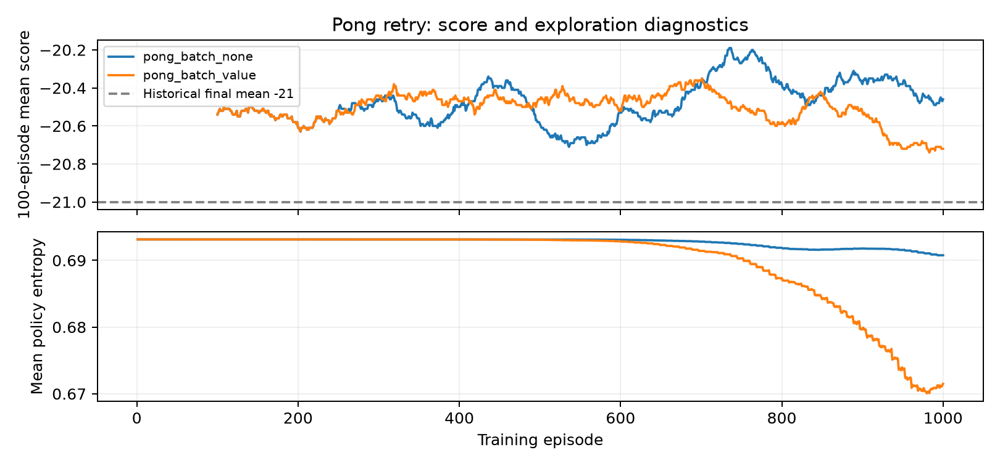

Entropy near log(2)=0.693 describes continued exploration, not successful play.
The exact discounted objective still downweights rewards late in a long Pong game.
Lower variance and stable exploration can coexist with weak task performance.

### Separate discounted-objective diagnostic

The following uses 200 additional episodes per policy and held-out environment seeds
starting at 6,000,000. It evaluates the exact full-episode gamma=0.99 objective, separate
from the main 500-episode score histograms. Paired intervals describe rollout uncertainty.

| Policy | Mean discounted return | Mean game score | Discounted gain vs random (approx. 95% interval) |
|---|---:|---:|---|
| random | -1.41354 | -20.415 | Reference |
| pong_batch_none | -1.25539 | -20.410 | 0.15815 [0.07257, 0.24373] |
| pong_batch_value | -1.24242 | -20.740 | 0.17112 [0.09682, 0.24542] |

Reproduce without training: `python src/evaluate_pong_objective.py --episodes 200 --device cpu`.
An interval including zero does not establish a clear objective gain. Even a positive
discounted gain would not establish that the full game has been mastered.

### Curves and evaluation histograms

**cartpole_none_lr0001**

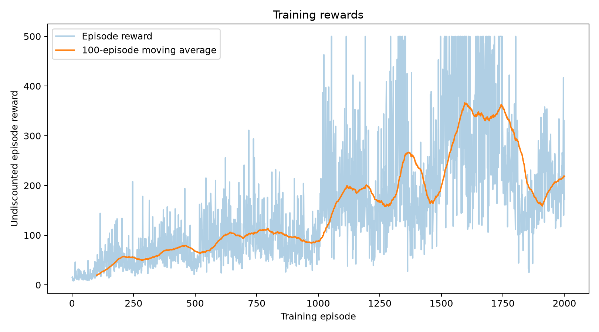
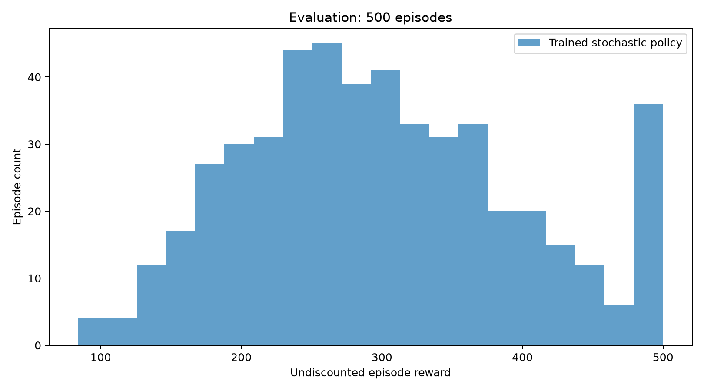

**cartpole_value_lr0001**

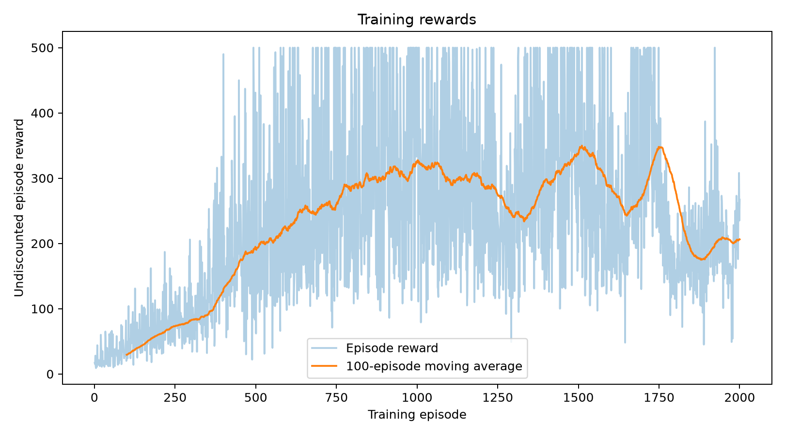
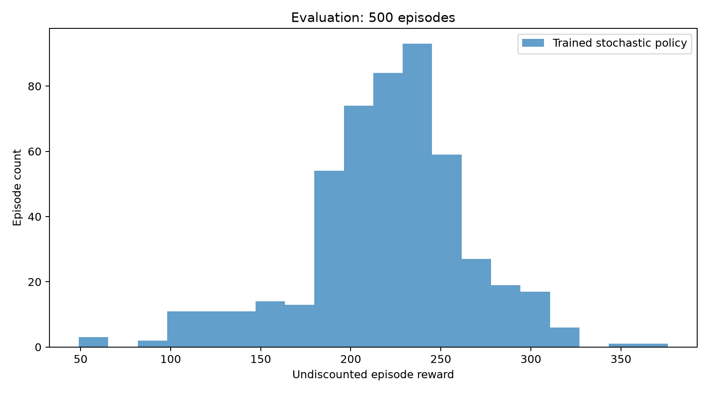

**pong_batch_none**

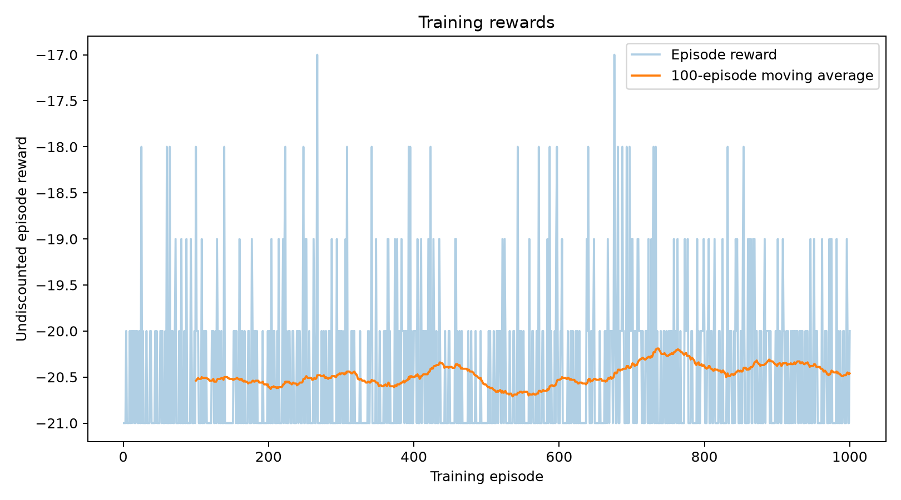
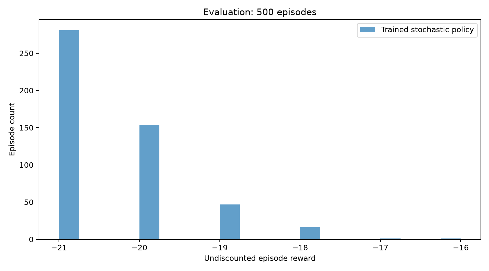

**pong_batch_value**

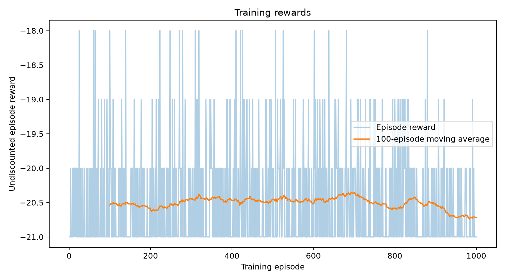
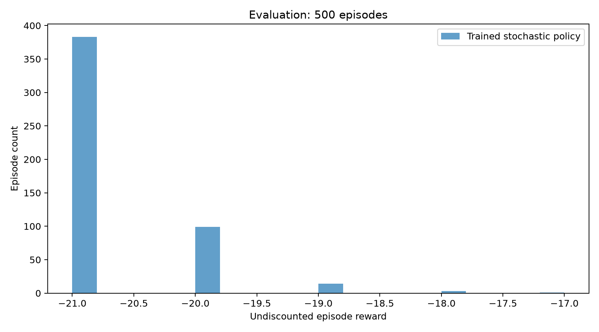

### Small environment demos

The initial CartPole smoke test used 5 training and 5 evaluation episodes. The
initial Pong smoke test used 2 training and 2 evaluation episodes. Their raw results
are in `results/demos/`; these are separate from all larger measured runs above.

### Report

[Complete PDF report](reports/assignment1_report.pdf). Regenerate with `python src/prepare_report_figures.py`
and `python src/build_report.py`; no new training is needed.
<!-- MEASUREMENTS END -->


### Additional Pong training-budget experiment: 3,000 episodes

Both existing 1,000-episode runs were resumed to a total of 3,000 episodes
(2,000 additional episodes each). The training implementation, environment,
architecture, learning rates, batch size, discounting, seed and device were unchanged.
The original 1,000-episode results are preserved. Each final policy was evaluated
for 500 episodes using the same held-out environment seeds as before.

| Baseline | 1,000-episode evaluation mean | 3,000-episode evaluation mean ± sample SD | Total training environment steps |
|---|---:|---:|---:|
| none | -20.390 | -20.952 ± 0.214 | 2,856,725 |
| value | -20.720 | -20.548 ± 0.693 | 2,946,028 |

The paired random-policy reference mean is -20.514. The value-baseline policy
improved modestly, while the no-baseline policy deteriorated. Neither policy
learned successful Pong play. This single-training-seed experiment shows limited
benefit from extending this configuration to 3,000 episodes; it does not establish
what would happen at larger budgets or with other seeds.

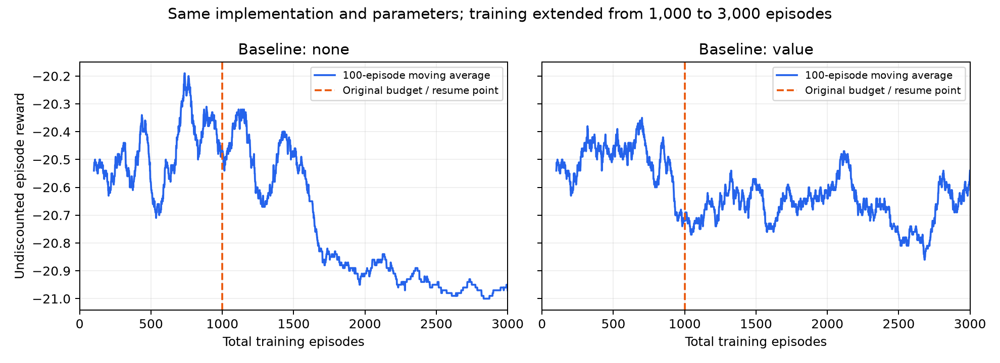

Raw CSVs, evaluation histograms, policies and full validation checkpoints are in
[no-baseline results](results/pong_budget3000_none/) and
[value-baseline results](results/pong_budget3000_value/).
[Provenance manifest](results/pong_budget3000_manifest.json) records the source
checkpoint/data hashes and unchanged training-code hashes;
[comparison audit](results/pong_budget3000_comparison.json) checks the preserved
1,000-episode CSV prefix and 375 total optimizer updates per group.
The recorded elapsed times cover the resumed process (2,000 additional training
episodes plus evaluation), not the entire 3,000-episode experiment.
The complete PDF report now includes both the earlier strict-objective experiments
and these subsequent budget and algorithm comparisons.


### Pong outer time-weighting ablation (completed)

An additional experiment compares the original `--time-weighting episode_discount`
with `--time-weighting uniform`. The default retains the original calculation.
Uniform weighting removes only the outer `gamma**t` actor weight; full-episode
reward-to-go still uses gamma=0.99. This changes the policy-gradient surrogate,
so it is recorded as a separate method rather than a correction to the original
start-state discounted objective.

Both branches start from the same preserved 3,000-episode checkpoints, including
actor, critic, Adam states and CPU Torch RNG, and target 5,000 total episodes.
Uniform weighting begins at episode 3,001. The architecture, learning rates,
batch size, gradient clipping, environment and seeds are unchanged. Each final
policy received 500 evaluation episodes. Original numerical results are preserved;
the complete PDF now includes the measured comparison.

[Control provenance](results/pong_budget5000_manifest.json) and
[uniform-weighting provenance](results/pong_uniform5000_manifest.json) describe
the paired branches. The original control processes loaded the
[recorded original training source](results/pong_budget5000_training_source.txt)
before the optional weighting argument was added.

Verify gradients with `python src/test_pong_time_weighting.py`. This compares both
modes, with and without the value baseline, against an independent unchunked loss
and checks that actor backpropagation leaves the critic detached.
After all four runs finish, `python src/summarize_time_weighting.py` audits counts,
checkpoint update steps, preserved CSV prefixes and paired evaluation statistics,
and writes the comparison plot and measured results to this README.


### Fixed-budget input representation experiment

Two fresh value-baseline models compare `--representation stacked_frames` with
`--representation split_frame_difference`. Each uses 3,000 training episodes and
500 evaluation episodes. Both use uniform actor time weights from episode 1,
the same two-channel CNN, gamma=0.99 reward-to-go, actor lr=0.0001, critic
lr=0.0003, batch size 8, gradient clipping 5 and seed 0.

The motion representation has two binary channels: pixels appearing since the
previous frame, and pixels disappearing. Their difference reconstructs the
signed frame difference exactly. Splitting signs preserves them through packed
binary trajectory storage. The network structure is unchanged. Resuming a
checkpoint with another representation is rejected; both comparison models
start fresh with fresh optimizers.

[Experiment manifest](results/pong_representation_manifest.json) and
[frozen training source](results/pong_representation_training_source.txt) record
the protocol. [Real-environment input check](results/pong_motion_input_check.png)
shows the two motion channels. `python -m unittest discover -s src -p 'test_pong_*.py'`
checks encoding, packing, rollout inputs and both time-weighting gradients.
A separate smoke test used 2 training episodes and 2 evaluation episodes; it is
not part of the measured 3,000-episode comparison.

`python src/run_representation_comparison.py --episodes 3000 --device mps` runs the
comparison once in a fresh results location. The launched local batch waits for
the preceding weighting experiment to finish delivery, then automatically runs
both inputs, audits results and publishes measured outputs. The completed comparison is reported below and in the complete PDF.


<!-- TIME WEIGHTING RESULTS START -->
### Measured Pong time-weighting comparison

Both branches start from the same 3,000-episode checkpoint and reach 5,000 episodes.
Uniform weighting starts at episode 3,001; all other hyperparameters and inherited optimizer states match.

| Time weighting | Baseline | 500-episode evaluation mean ± sample SD |
|---|---|---:|
| control | none | -20.724 ± 0.563 |
| control | value | -20.170 ± 0.916 |
| uniform | none | -20.444 ± 0.798 |
| uniform | value | -19.954 ± 1.141 |

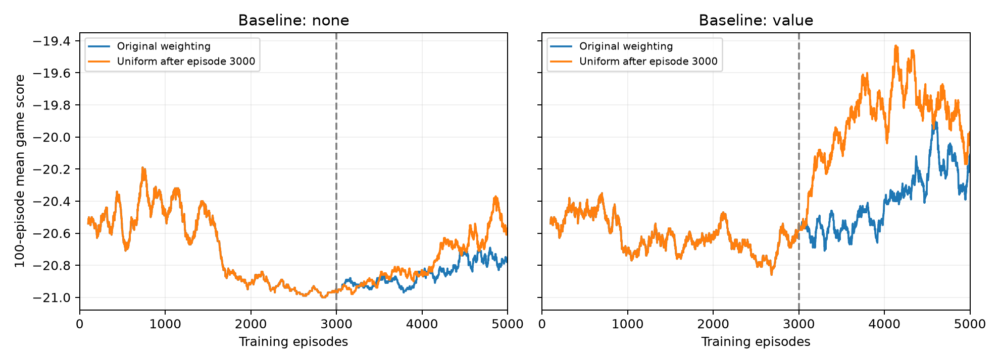

[Audit and paired differences](results/pong_time_weighting_comparison.json).
This is one training seed and a warm-start experiment. Uniform time weighting changes
the gradient surrogate; gamma=0.99 remains inside reward-to-go. These experiments are included in the complete PDF report.
<!-- TIME WEIGHTING RESULTS END -->

### Measured fixed-budget input comparison

| Input | Training episodes | 500-episode evaluation mean ± sample SD |
|---|---:|---:|
| stacked_frames | 3000 | -20.010 ± 1.217 |
| split_frame_difference | 3000 | -19.888 ± 1.038 |

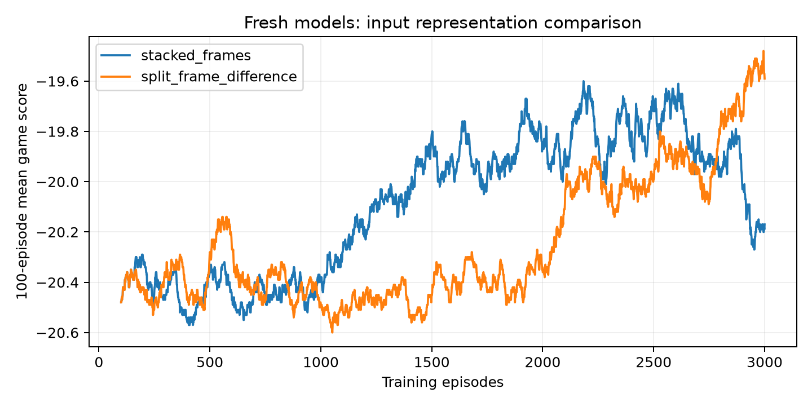

[Raw comparison and uncertainty](results/pong_representation_comparison.json).
Both models start fresh; only the input encoding differs. Uniform time weights, the CNN,
value baseline, learning rates, batch size and seeds match. These experiments are included in the complete PDF report.


### Fixed-budget actor learning-rate experiment

The unchanged 3,000-episode `pong_repr_motion_value` run at actor lr=0.0001
is reused as the measured control. Two new policies start fresh at actor
lr=0.0003 and 0.001, each for 3,000 episodes and 500 evaluation episodes.
All groups retain split-frame-difference inputs, the same CNN, independent value
baseline at lr=0.0003, uniform actor time weighting, gamma=0.99 reward-to-go,
batch size 8, gradient clipping 5, seed 0, MPS and held-out environment seeds.
The only between-group change is actor learning rate.

[Protocol and control hashes](results/pong_learning_rate_manifest.json) record
the frozen training implementation. `python src/run_learning_rate_comparison.py --device mps`
runs this comparison once; the already-launched local batch uses `--publish` to
save audited results to GitHub when complete. The first batch of rollout
statistics matches the unchanged control before the first updated learning-rate
step. New training data is written to separate result directories.

An [environment diagnostic](results/pong_control_diagnostic.json) records 10
hand-coded tracking and 10 random episodes on separate seeds, plus paddle
responses to actions 2 and 3. Those actions move the paddle upward and downward,
respectively; episodes terminate with valid returns. The simple tracking
controller averages -16.1 and is weak. It is not a learned policy or evidence
of successful training. New learning-rate results are reported only after
training and evaluation finish.

### Measured fixed-budget actor learning-rate comparison

| Actor learning rate | 500-episode mean ± sample SD |
|---|---:|
| 0.0001 | -19.888 ± 1.038 |
| 0.0003 | -19.122 ± 1.407 |
| 0.001 | -7.742 ± 6.311 |

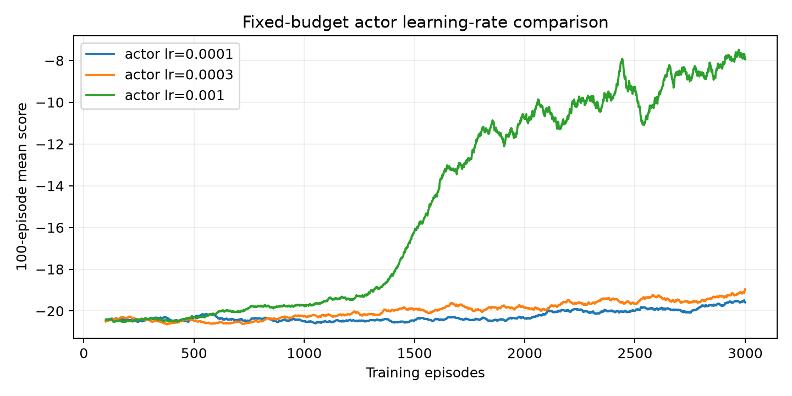

[Raw comparison and paired intervals](results/pong_learning_rate_comparison.json).
The unchanged 0.0001 control is reused; the two new policies start fresh. This is a one-seed exploratory comparison. These experiments are included in the complete PDF report.


### Independent confirmation of the selected learning rate

The learning-rate comparison selected actor lr=0.001 using training seed 0.
Two fresh models used training seeds 1 and 2, each for 3,000 episodes and
500 evaluation episodes. The frozen implementation, CNN, motion input, independent
value baseline, critic lr=0.0003, uniform actor time weighting, gamma=0.99,
batch size 8 and clipping 5 remain fixed. Seed changes affect initialization,
action sampling and the existing per-seed training/evaluation environment ranges.
The seed-0 result is preserved and reused, not retrained.

[Validation manifest](results/pong_seed_validation_manifest.json) records source
hashes and the selected run. `python src/run_seed_validation.py --device mps` runs
this validation once. The launched batch also uses `--publish` to upload audited
results after completion. It reports each seed separately, the average of the
two independent confirmation seeds, and variability between the three seed means.
These are three trained models, not 1,500 independent training runs. This checks
the selected configuration's reproducibility; no new low-rate control models
are included. Three training seeds remain a small sample. No new performance
results are claimed before the runs complete.

### Independent training-seed confirmation at actor lr=0.001

| Training seed | Role | 500-episode mean ± sample SD |
|---|---|---:|
| 0 | selection_run | -7.742 ± 6.311 |
| 1 | independent_confirmation | -9.250 ± 3.668 |
| 2 | independent_confirmation | -10.032 ± 3.796 |

Mean across three training-seed means: -9.008; sample SD between seed means: 1.164.
The two independent confirmation runs average -9.641.

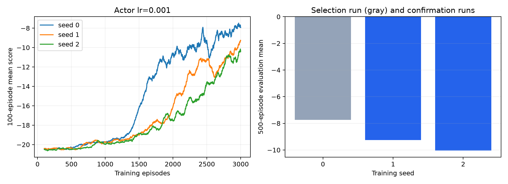

[Raw results and scope](results/pong_seed_validation.json). Seed 0 was used for selection; seeds 1 and 2 were held out from that selection. Three training seeds remain a small sample. These experiments are included in the complete PDF report.
