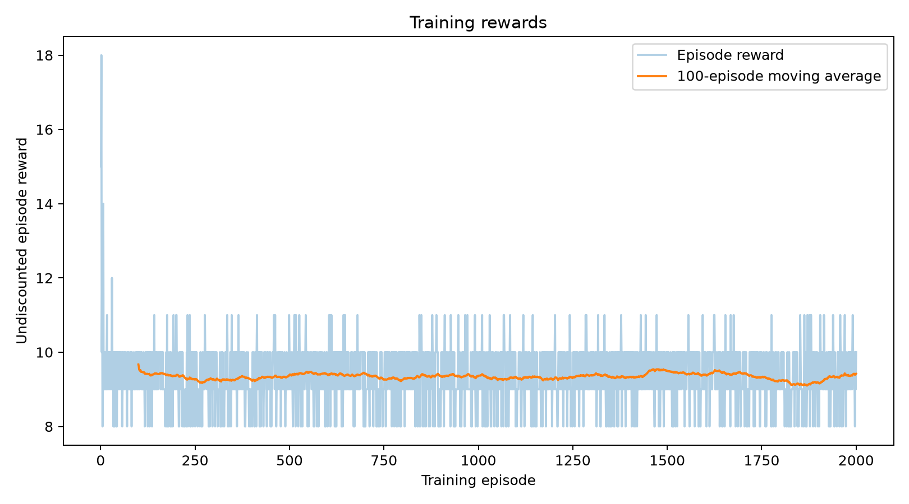
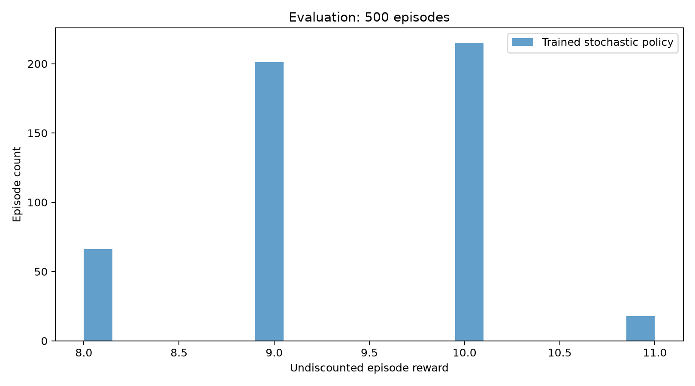
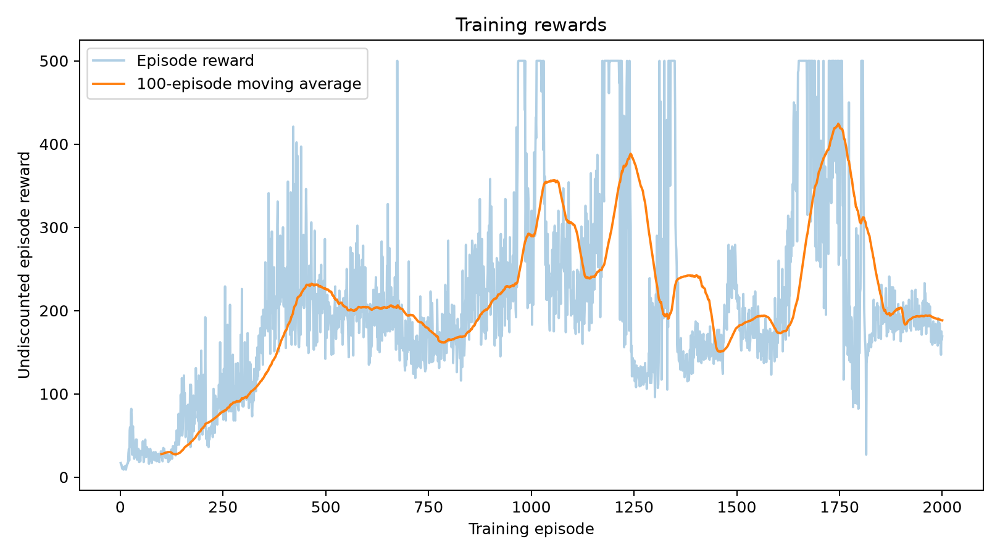
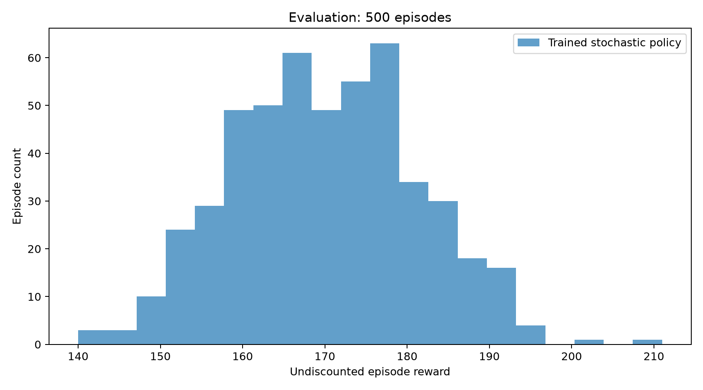
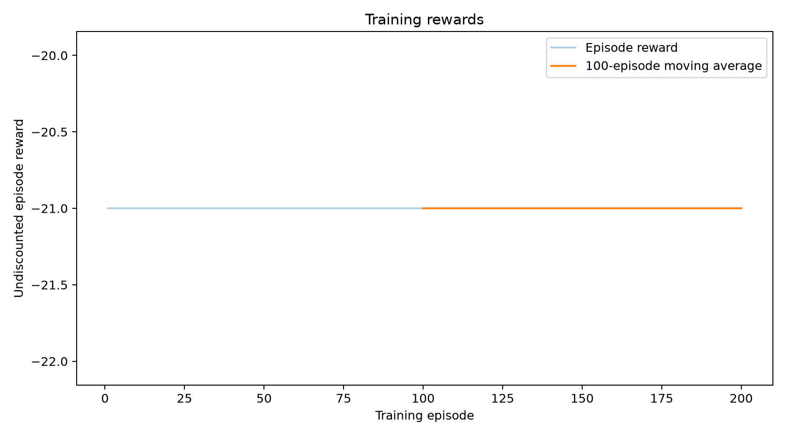
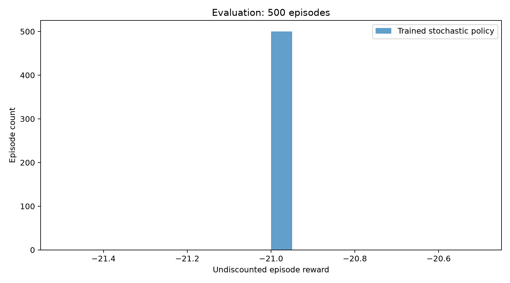
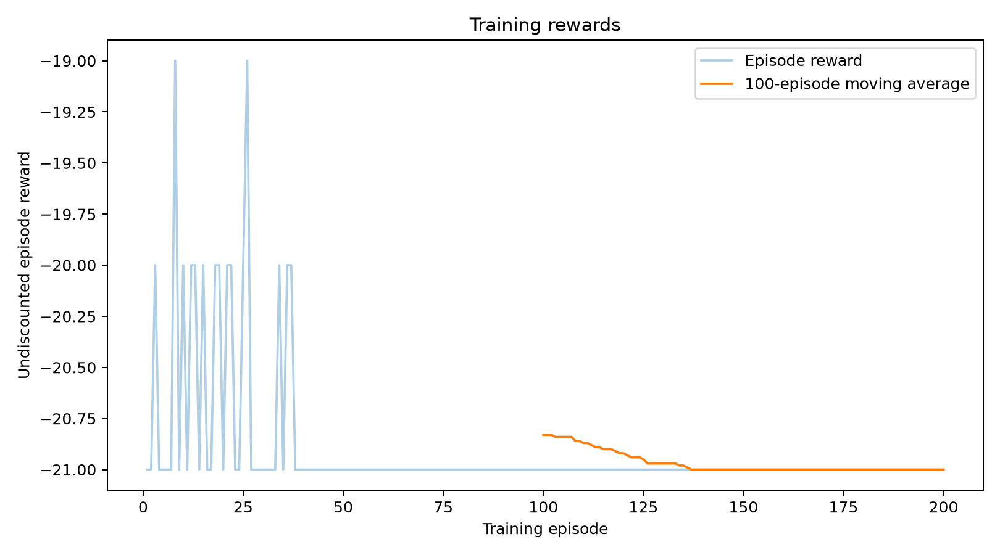

# MLDS Assignment 1: Reinforcement Learning

**GitHub username:** Dorrie-ge  
**Repository:** [Dorrie-ge/mlds-assignment1-rl](https://github.com/Dorrie-ge/mlds-assignment1-rl)

This repository implements the shuttle dispatch MDP, episodic REINFORCE, and
REINFORCE with a learned state-value baseline. Results are measured runs. Short
training budgets do not establish that a game is solved. Failed runs are retained.

## Installation

Python 3.12 was used. Create a local environment, then install the recorded dependencies:

```bash
python3 -m venv .venv
source .venv/bin/activate
python -m pip install -r requirements-lock.txt
```

The lock file records the actual macOS ARM CPU run. On a different platform,
`requirements.txt` provides the top-level dependencies; record any version changes.
Neither the virtual environment nor Atari ROM files are committed.

## Reproduce the main experiments

Run from the repository root. The original runs used CPU and one PyTorch thread.
Each game command evaluates both a random policy and the final stochastic policy
on 500 episodes. Evaluation freezes the trained weights and uses separate seeds.

```bash
python shuttle.py --out results/shuttle
python validate_shuttle_simulation.py
python policy_gradient.py --test-only
python policy_gradient.py --game cartpole --baseline none --episodes 2000 --eval-episodes 500 --out results/cartpole_none
python policy_gradient.py --game cartpole --baseline value --episodes 2000 --eval-episodes 500 --out results/cartpole_value
python policy_gradient.py --game pong --baseline none --episodes 200 --eval-episodes 500 --out results/pong_none
python policy_gradient.py --game pong --baseline value --episodes 200 --eval-episodes 500 --out results/pong_value
```

The seed is 0 and actor learning rate is 0.01 unless explicitly changed. For a
quick environment demo, use `--episodes 5 --eval-episodes 5` for CartPole or
`--episodes 2 --eval-episodes 2` for Pong, and choose another output directory.
Those small evaluation budgets do not meet the assignment's 500-episode requirement.

Longer training can be requested with `--episodes 20000` and a new output directory.
That command describes a future experiment; it is not a completed result here.

## Shuttle MDP

- State `s`: customers waiting before dispatch, 0 through 200.
- Action `a`: wait (0), or dispatch one shuttle (1), capacity 15.
- Customers remaining: `left = max(s - 15*a, 0)`.
- Immediate cost: `100*a + 2*left`.
- Next state: `min(200, left + A)`, with independent uniform arrivals 1 through 5.
- Discount: 0.95. Ties choose wait. Empty dispatch is allowed and costs 100.

Dispatch occurs before holding cost and arrivals. Arrivals above the queue cap
are discarded without additional penalty; this is an explicit boundary assumption.
Finite-horizon terminal cost at time 500 is zero. Values plotted here are positive
costs to minimize. With reward `r=-cost`, reward-maximizing values have the opposite sign.

Finite-horizon enumeration means enumerating all states, actions, and arrival
outcomes in backward induction. It does not mean enumerating 2^500 open-loop
action sequences. A classroom-specific definition of enumeration should be checked
against the course notes.

The infinite-horizon policy waits at states 0-12 and dispatches at 13-200.
Its optimal expected discounted cost at state 0 is approximately 576.670168.
The VI stopping rule is a maximum Bellman residual below 1e-10. PI solves the
policy's linear system and improves the policy until unchanged.


`results/shuttle/values.csv` contains all values; `validation.json` records the
executed tests. VI and PI agree on every state action. Their maximum value
difference is below 2e-9. The finite-horizon versus infinite-horizon difference
is below 3e-9 for T=500.

## Policy gradient implementation

The optimization target is the start-state discounted episode return
`J = E[sum_t gamma**t * r_t]`. Rewards-to-go are computed over the full episode:
`G_t = sum_{k=t}^{T-1} gamma**(k-t) * r_k`.
The actor minimizes `-sum_t gamma**t * log pi(a_t|s_t) * (G_t - b(s_t))`.
The explicit outer `gamma**t` preserves this particular discounted objective.
It also downweights late actions in long Pong games; this is a limitation to examine.

Without a baseline, `b=0`. With a baseline, a separate value network predicts
`b(s_t)` before fitting that episode. Its prediction is detached in the actor loss.
The critic minimizes MSE to Monte Carlo rewards-to-go using a separate Adam
optimizer with learning rate 0.001. The actor uses Adam with default learning
rate 0.01. One complete episode is used per actor update. No return normalization,
reward clipping, point-based return resets, entropy bonus, or PPO is applied.

CartPole uses a 4-input MLP with 128 tanh hidden units and 2 output logits.
Pong uses the supplied 80x80 binary preprocessing and stacks the previous and
current frames to represent motion. The first pair duplicates the initial frame.
Its CNN uses 16 filters (8x8, stride 4), then 32 filters (4x4, stride 2), then a
128-unit hidden layer and 2 output logits. The value network has the same body
with a scalar output. Each game resets frame history.

The modern Atari environment name is `ALE/Pong-v5`, with the v5 defaults
frameskip=4 and repeat_action_probability=0.25. Policy outputs 0/1 map exclusively
to environment actions 2/3 (`RIGHT`/`LEFT`). See [official Pong documentation](https://ale.farama.org/environments/pong/).
CartPole uses `CartPole-v1` and gamma=0.95; Pong uses gamma=0.99.
Both termination and truncation end the sampled episode. No terminal bootstrap is
added: the objective is the observed finite rollout. Reported game rewards are
undiscounted total scores, whereas optimization uses discounted rewards.

## Validation

Shuttle validation is rerun automatically with `shuttle.py`:

1. Compare backward induction against independent recursive decision-tree
   enumeration on a 5-state, 2-arrival, 4-step problem: maximum difference 0.
2. Compare VI, PI, finite-horizon costs, and the Bellman optimality residual.
3. Make dispatch free: dispatch at all positive states. Make capacity zero:
   never dispatch. Set gamma=0: future costs disappear.
4. Check the empty station and the upper boundary explicitly. At s=200, waiting
   clips all arrivals to 200; dispatching produces next states 186 through 190.

Policy-gradient validation includes the following:

```bash
python policy_gradient.py --test-only
python validate_policy_gradient.py --game cartpole --checkpoint results/cartpole_value/checkpoint.pt --episodes 64 --out results/validation_cartpole.json
python validate_policy_gradient.py --game pong --checkpoint results/pong_value/checkpoint.pt --episodes 16 --out results/validation_pong_collapsed.json
python policy_gradient.py --game pong --baseline value --episodes 20 --eval-episodes 2 --seed 7 --lr 0.0001 --out results/pong_value_early_diagnostic
python validate_policy_gradient.py --game pong --checkpoint results/pong_value_early_diagnostic/checkpoint.pt --episodes 16 --out results/validation_pong.json
```

- A two-step analytic task enumerates all action pairs and compares the exact
  discounted-objective gradient to the expected score-function gradient, with
  and without a baseline. Errors are below 6e-8 in float32.
- A central finite difference through the actual CartPole network checks one
  actor parameter against autograd, with absolute error about 4.2e-12.
- At a **frozen actor**, held-out trajectories are used to measure the trace of
  the full actor-gradient covariance, with and without the learned baseline on
  the same trajectories. A paired bootstrap gives an exploratory interval for
  the variance ratio. This tests gradient variance directly; reward variance is
  not used as a substitute. These are single-checkpoint, limited-sample results.
- `first_10_steps.json` supports inspection of action mappings, rewards, and
  episode-ending flags. Output CSVs retain every training and evaluation reward.
- Random-policy comparisons and learning-rate trials expose weak or collapsed
  runs instead of treating code execution as evidence of successful learning.
- An independent shuttle simulator uses 40,000 rollouts from each of five starting
  states. Four of five DP values lie inside marginal 95% intervals; the state-15
  discrepancy is 2.44 standard errors. All five lie inside the simultaneous 95%
  Bonferroni intervals. Results are retained without selecting a more favorable seed.

The final Pong actor has nearly zero gradient covariance (about 4e-49). Its ratio
is marked numerically uninformative in `validation_pong_collapsed.json`. The
supplementary 20-episode, lr=0.0001 checkpoint is used for a comparison before that
collapse. Its 2-episode score evaluation is a diagnostic, separate from the four
main experiments and their 500-episode evaluations.
The preliminary variance log is retained in `logs/` for debugging history; its
near-zero-denominator ratio is superseded by the flagged collapsed-policy diagnostic.

Checkpoints are generated every 100 training episodes and are ignored by Git.
To rerun frozen-policy validation after cloning, regenerate the corresponding
training checkpoint with the commands above. Final policy weights are committed.

## Further experiments with three additional months

Use multiple independent training seeds and confidence intervals; compare
learning rates, batch sizes, architectures, constant baselines, and value
baselines at matched budgets. Repeat frozen-policy gradient-variance experiments
at early, middle, and late checkpoints. Test the impact of the precise discounted
objective on sparse Pong rewards, and clearly label any alternative objective.
For shuttle dispatch, vary capacity, arrival distributions, holding costs, queue
caps, and overflow rules; compare DP costs with independent simulated returns.
For game robustness, evaluate initial-state perturbations, observation noise,
and changed sticky-action probabilities as separately labeled experiments.

## Files

- `shuttle.py`: finite-horizon enumeration, VI, PI, and numerical validation.
- `policy_gradient.py`: training, stochastic evaluation, weights, CSVs, and figures.
- `validate_policy_gradient.py`: numerical derivatives and frozen-policy variance.
- `validate_shuttle_simulation.py`: independent Monte Carlo verification of DP costs.
- `results/`: actual measurements and plots.
- `requirements-lock.txt`: exact installed package versions.
- `audit_results.py`: check raw CSV counts, summary means, and standard deviations.
- `build_report.py` and `summarize_results.py`: regenerate the PDF and README tables.

<!-- MEASUREMENTS START -->
## Measured results

Main experiments, seed 0 and actor learning rate 0.01. All evaluation budgets below are 500 episodes.

| Environment | Baseline | Training episodes | Mean reward | Sample SD | Random-policy mean |
|---|---|---:|---:|---:|---:|
| CartPole-v1 | none | 2000 | 9.370 | 0.755 | 21.906 |
| CartPole-v1 | value | 2000 | 170.168 | 11.184 | 21.906 |
| ALE/Pong-v5 | none | 200 | -21.000 | 0.000 | -20.412 |
| ALE/Pong-v5 | value | 200 | -21.000 | 0.000 | -20.412 |

The default-lr CartPole run without a baseline collapsed. The value baseline improved that
particular run. Pong did not learn successful play within 200 training episodes; its weak
results are retained. No performance for 20,000 or more training episodes is claimed.

### Learning-rate and seed checks

These are actual additional CartPole experiments. Each uses 2,000 training episodes and
500 evaluation episodes. Exploration of hyperparameters uses these evaluation results, so
the best number is not a fresh, untouched model-selection test.

| Baseline | Learning rate | Seed | Mean reward | Sample SD |
|---|---:|---:|---:|---:|
| none | 0.001 | 0 | 300.240 | 97.968 |
| none | 0.001 | 1 | 92.460 | 31.626 |
| none | 0.001 | 2 | 106.554 | 28.962 |
| none | 0.003 | 0 | 171.432 | 42.960 |
| value | 0.001 | 0 | 220.218 | 45.618 |
| value | 0.001 | 1 | 362.986 | 121.367 |
| value | 0.001 | 2 | 214.266 | 69.583 |

At actor lr=0.001, matched-seed evaluation means across seeds 0, 1, and 2 were:

- Baseline `none`: mean of the three policy means = 166.418; between-seed sample SD = 116.107.
- Baseline `value`: mean of the three policy means = 265.823; between-seed sample SD = 84.198.

This between-seed SD is different from the rollout SD in each individual table row.

Reproduce the supplementary configurations by adding `--lr 0.001 --seed 0/1/2`
or `--lr 0.003 --seed 0` to the CartPole commands and choosing a new output directory.

### Frozen-policy gradient variance

| Game | Held-out trajectories | Plain variance trace | Baseline variance trace | Ratio | Bootstrap 95% interval |
|---|---:|---:|---:|---:|---|
| cartpole | 64 | 7280.52 | 6.76759 | 0.000929547 | [0.000704755, 0.00126997] |
| pong | 16 | 209.838 | 34.0366 | 0.162205 | [0.115377, 0.217259] |

The actor is frozen, and both gradient estimators use exactly the same held-out
trajectories. Ratios below 1 show empirical variance reduction at that checkpoint;
ratios above 1 show increased variance. A learned baseline does not guarantee a lower
variance or a better score. These samples and bootstrap intervals are exploratory.

### Curves and evaluation histograms

**cartpole_none**




**cartpole_value**




**pong_none**




**pong_value**




### Small environment demos

The initial CartPole smoke test used 5 training and 5 evaluation episodes. The
initial Pong smoke test used 2 training and 2 evaluation episodes. Their raw results
are in `results/demos/`; these are separate from all larger measured runs above.

### Report

[PDF report](assignment1_report.pdf). Regenerate with `python summarize_results.py`
and `python build_report.py` after the measurements and variance experiments finish.
<!-- MEASUREMENTS END -->
